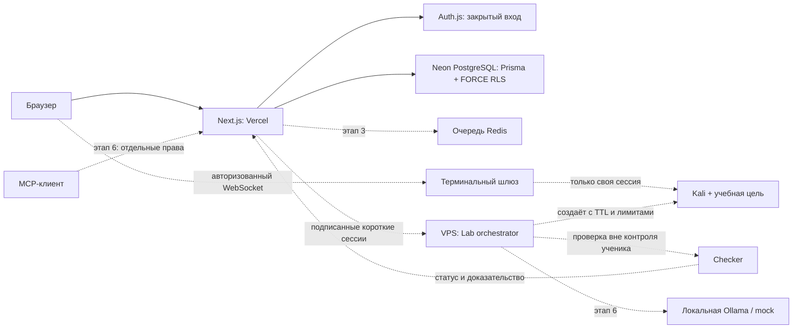

# Архитектура Kairon

## Текущее состояние: Этап 0

Next.js 16 App Router, TypeScript, Tailwind 4, shadcn-style Button на Radix Slot. Каталог программы, поиск, фильтры, русский/английский интерфейс, словарь, правила, закрытый вход Auth.js, защищённые профиль и административная страница. Аккаунты выдаются через CLI владельца БД. Редактора контента пока нет.

PostgreSQL/Prisma: User, AuditLog, LoginAttempt. Миграция включает FORCE RLS, ограниченную роль runtime, функции входа и атомарный лимит попыток. Операции с данными пользователя выполняются в транзакции с SET LOCAL. Идентификатор берётся из проверенной серверной сессии.

Не реализованы: учебный движок, сохранение прогресса/XP, проверка заданий, контейнерные сессии, AI-наставник, MCP, сертификаты, Redis-очереди и продакшен-мониторинг. Каталог показывает будущую программу с явным статусом «В разработке». Черновик формата урока — данные для следующего этапа, не доступная лаборатория.

## Целевая схема

Пунктиром отмечены будущие компоненты. Vercel не запускает Kali/Docker и не держит терминальные сессии. Миграции выполняются отдельно: DIRECT_URL владельца не нужен веб-приложению в production.

## Структура

- `src/app` — маршруты, Server Actions и API.
- `src/components` — оболочка, каталог, формы, UI.
- `src/lib` — auth, роли, транзакции, словарь и программа.
- `prisma` — схема и SQL-миграции.
- `scripts` — настройка окружения, выдача аккаунтов и проверка БД.
- `content` — JSON Schema и Markdown/JSON черновики уроков.
- `services/lab-orchestrator` — описание границ будущего сервиса.
- `tests` — unit и браузерные проверки.
- `docs` — архитектура, аудит источников, план VPS и эксплуатация.

## Формат «объяснение рядом с заданием»

`Path → Module → Lesson → Task`; `Lesson` содержит короткую теорию, аналогию, цель, ссылки на словарь и источник с автором/лицензией/SHA. `Task` ссылается на утверждённый шаблон лаборатории и серверный checker. Ответы, приватный разбор, команды проверки и эталоны не отправляются браузеру до разрешённого состояния.

`Attempt` хранит владельца, задачу, статус `pass/fail/infra_error`, использованные подсказки и проверочную версию. `Progress` и `XpEvent` имеют userId и уникальные ключи для защиты от повторного начисления. `LabSession` принадлежит пользователю и имеет TTL, template revision, state. Эти модели будут добавлены на своих этапах; схема Этапа 0 их пока не создаёт.

Успешный pytest с пропущенным обязательным тестом не считается решением. Режимы mock/cached/Ollama различаются в интерфейсе и проверке. Ошибка инфраструктуры не засчитывается и не отнимает попытку.

## Этапы и критерии перехода

0. Фундамент: локальная сборка, PostgreSQL/RLS и auth-проверки, CI, документация, пустой сайт на Vercel. Пока не подтверждены облачная БД, CI и деплой, этап не объявляется законченным.
1. Ядро: модели Path/Module/Lesson/Task, Markdown, последовательное открытие, CRUD контента.
2. Проверка: серверные ответы, лимиты, атомарное XP, профиль/значки/лидерборд.
3. Лаборатории: VPS, изоляция с отрицательными тестами, таймер, Kali/цель, WebSocket.
4. Контент MVP: Старт с нуля и первая половина Red Team; полноценные проверенные уроки.
5. Blue Team: проверенные события/PCAP, SOC; AD требует отдельной VM-инфраструктуры.
6. ИИ/MCP и Путь 4: локальная Ollama, явно помеченный mock, ограниченный наставник и пять адаптеров лабораторий.
7. Качество/безопасность: аудит платформы, резервное копирование, нагрузка, мониторинг, юридические тексты для выбранной юрисдикции.
8. Запуск: домен/HTTPS, админская инструкция, пробная группа и обратная связь.

У каждого этапа — Conventional Commit, README со статусом и проверки перед переходом. Наличие файлов конфигурации не заменяет проверку работающей инфраструктуры.
